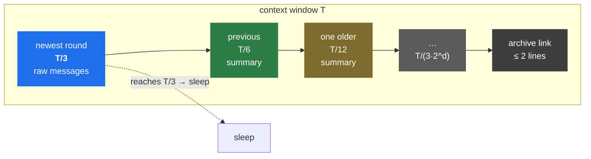
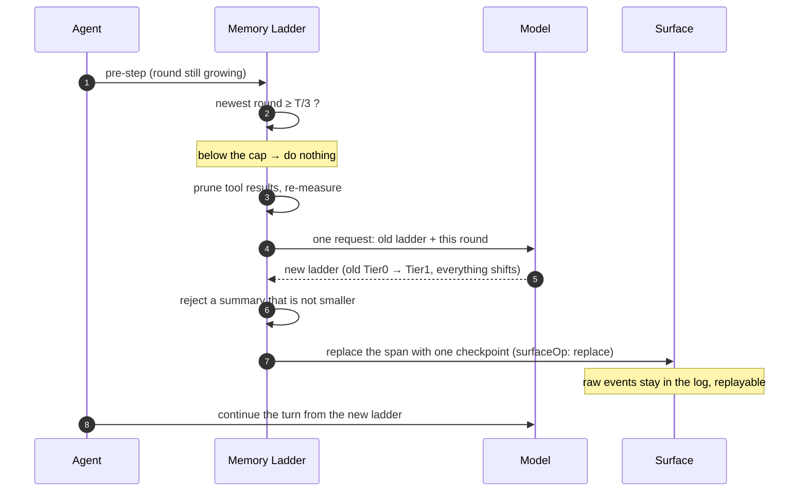

# dsh-memory-ladder

> A tiered "sleep" compaction backend for DeepSeek Harness. The newest round owns **T/3** of the context window, every older tier halves (T/6, T/12, T/24 …), and one model call rewrites the doomed history into a traceable memory ladder.

English | [中文](README.md)

## Why

Default compaction waits until the window is nearly full, then condenses the oldest span into one summary. Two problems follow:

1. **Late trigger** — at 80% of the window the summarization request itself already replays almost everything.
2. **Lost depth** — old and new content merge into one summary, so the model cannot tell what just happened from what is background.

Memory Ladder organises context by **recency instead of size**: the newest round always gets the largest budget, older tiers shrink geometrically, and the oldest memory collapses into a single link.

## Policy

With `T` = the routed model's context window:

| Tier | Content | Budget |
|---|---|---|
| newest round | every raw message since the last checkpoint | `T/3` |
| previous round | the summary produced by the last sleep | `T/6` |
| one sleep older | the tier above, pushed down | `T/12` |
| … | halves per level | `T/(3·2^d)` |

The newest-to-previous ratio therefore stays at **2:1**.



One sleep, end to end:



### What a sleep does

1. The newest round reaches `T/3` (or the provider reports context overflow).
2. One model call rewrites "old ladder + this round's raw transcript" into a new ladder: old Tier 0 becomes the new Tier 1, everything shifts down, the deepest tier drops into the archive link.
3. The compaction transaction replaces the shadowed span with **one** user message (`surfaceOp: replace`); the raw events stay in the session log and remain replayable.
4. The turn continues from the new ladder.

`/compact` reuses the same path, skipping only the threshold check.

## Measured

One real task (a 20-minute CrowdStrike incident investigation), same policy, two windows:

| | default `T/3` (1M window) | 32k-equivalent window |
|---|---|---|
| Trigger | 349,525 tokens | 10,905 tokens |
| Peak context | 185,359 tokens | 32,636 tokens |
| Sleeps | 0 | **10** |
| Surface nodes | 266 | 142 |
| Output | 41 KB / 23 sources | 16 KB / 10 sources |

The trade-off is capacity, not fidelity: core early facts survived ten sleeps, second-order detail decayed with the tiers. Method and raw numbers: [docs/experiment.md](docs/experiment.md).

## Install

This is a Harness **bundle**: it ships a `cordis.patch.yml` that disables the shipped compaction backend and inserts its own row.

```bash
dsh plugin --profile <profile> add dsh-memory-ladder
```

> ⚠️ `compaction-basic` **must** be disabled. `ctx.compaction` accepts a single implementation; mounting both fails at startup with `service "compaction" has been registered`. The bundled patch does this for you — do it manually only if you install by hand.

## Configuration

See the table in `README.md`. Defaults: `newestFraction = 1/3`, `tierCount = 6`, `minTierTokens = 200`, `maxSummaryTokens = 8192`, `minCompactionTokens = 512`, `auto = true`.

## Compatibility

Verified against `@deepseek-ai/dsh@0.2.1-rc.5` on Node 22/24. The package extends `BasicCompactionEngine` from `@deepseek-ai/dsh-compaction-basic` (MIT): the transaction is upstream, only the policy and `summarize()` are replaced. `peerDependencies` pins that version; an upstream refactor of the base class can break this package.

## Limitations

- An indivisible oversized message cannot be repaired by surface compaction.
- Each sleep costs one full-context model request.
- Older tiers decay by design; this is lossy.
- Summary fidelity depends on the model.

## License

MIT. Derived from `@deepseek-ai/dsh-compaction-basic` (MIT); attribution in [LICENSE](LICENSE).
