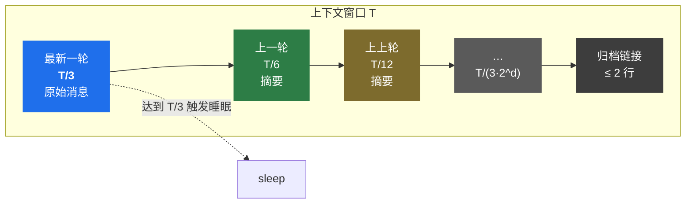
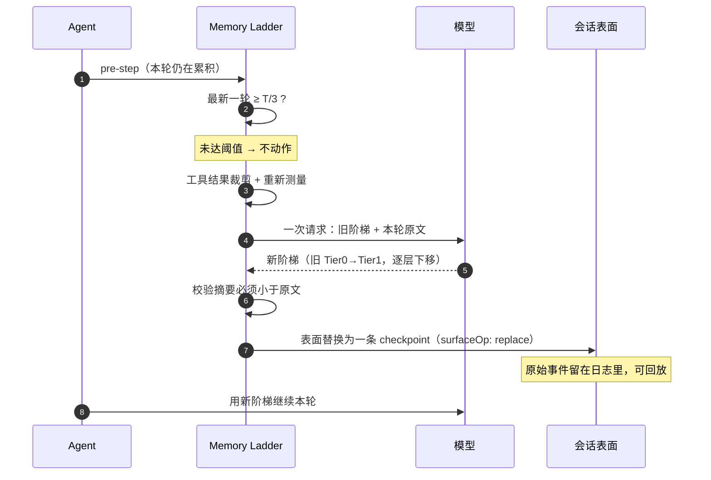

# dsh-memory-ladder

> DeepSeek Harness 的分层「睡眠」压缩后端：最新一轮独占窗口的 **1/3**，更早的层级逐层减半（T/6、T/12、T/24…），一次模型调用把将被丢弃的历史重写成一条可追溯的「记忆阶梯」。

[English](README.en.md) | 中文

## v0.2：可恢复原文的记忆阶梯

新版保留原有分层睡眠事务，并在压缩前将用户、助手及工具消息的文本写入当前会话独立的归档。下一步根据用户问题检索已经离开上下文的原文，经 Harness 的动态上下文接口提供给模型；不会直接改写冻结的模型请求。

- 默认归档位置：会话工作目录下 `.dsh-memory-ladder/`，文件名使用会话 ID 的 SHA-256。
- 原文保留消息 ID、角色和顺序。重复压缩不会重复归档同一消息；系统指令、旧检查点和运行时上下文不归档。
- 模型旧回答降权；疑似提问不作为主要事实来源。该排序不是事实验证或安全边界。
- 超长消息可返回带原文位置的有界摘录。归档本身保留完整文本；摘录不等于整条消息。
- `maxSummaryTokens` 现在是实际的输出上限；每次睡眠只调用一次摘要模型。层级预算会在输出上限内按比例缩小。

真实原生插件对照、每次请求/响应及失败记录见 [评测方法](docs/EVALUATION.md) 和 [原生留出结果](docs/evidence/native-v1/RESULTS.md)。此前独立原型的高分不被当成当前插件的发布证据。归档检索可能增加相对纯摘要的输入费用；请按正确率与费用分别评价。

在已登记的12个合成留出案例中（每模型96题），Flash 从原版76/96提升到90/96，Pro从84/96提升到91/96。费用相对原版增加约32%/31%，相对完整历史降低约28%/34%。完整历史仍为96/96。这是特定压缩压力下的质量/费用取舍，不是所有长任务或自由跑团均更优的证明。保留了消融组的一次失败、所有逐题错误、先前探索中结论反转的记录，以及原始请求/响应与校验和。

归档是本地明文状态，不会自动上传到其他服务；被选中的摘录会随下一次模型请求发送给当前模型服务商。`archiveRecall: false` 同时停用此归档写入和检索。恢复同一会话 ID 可继续读取归档；fork 到新会话 ID 不会自动复制父会话归档。

## 它解决什么

默认压缩策略是「快到窗口上限时，把最老的一段压成摘要」。这在长任务里有两个问题：

1. **触发太晚**：等到 80% 才动手，压缩本身要重放整段历史，请求已经贴着上限。
2. **层级丢失**：压完之后新旧内容混成一个摘要，模型分不清哪些是刚才发生的事、哪些是十轮前的背景。

Memory Ladder 换一种组织方式：**让上下文按新旧分层，每层有各自的预算**——最新一轮永远有最大的空间，越远越薄，最远的只剩一行超链接。

## 策略

设路由模型的上下文窗口为 `T`：

| 层级 | 内容 | 预算 |
|---|---|---|
| 最新一轮 | 上次检查点之后的全部原始消息 | `T/3` |
| 上一轮 | 上一轮压缩出的摘要 | `T/6` |
| 上上轮 | 再往前的摘要 | `T/12` |
| … | 每深一层减半 | `T/(3·2^d)` |

最新一轮与上一轮的比例因此稳定在 **2:1**。

上表是上下文窗口决定的理论预算。v0.2还受 `maxSummaryTokens` 约束：当层级总预算超过摘要输出空间时，摘要各层按几何比例缩小，并保留检查点框架空间。



一次睡眠的完整链路：



### 一次「睡眠」发生什么

1. 最新一轮的 token 数达到 `T/3`（或模型报告上下文溢出）；
2. 一次模型调用把「旧阶梯 + 本轮原始记录」重写成新阶梯：旧 Tier 0 变成新 Tier 1，逐层下移，最深一层落进归档链接；
3. 事务把被遮蔽的整段历史替换成**一条**用户消息（`surfaceOp: replace`），原始事件仍留在会话日志里，可回放；
4. 本轮从新阶梯继续。

`/compact` 手动命令复用同一条路径，只是跳过阈值判断。

## 实测数据

在真实任务（一次 20 分钟的 CrowdStrike 事件调研）上对比同一策略的两种窗口：

| | 默认 `T/3`（1M 窗口） | 32k 等效窗口 |
|---|---|---|
| 触发线 | 349,525 token | 10,905 token |
| 峰值上下文 | 185,359 token | 32,636 token |
| sleep 次数 | 0 | **10** |
| 会话表面节点 | 266 | 142 |
| 产出 | 41 KB / 23 个来源 | 16 KB / 10 个来源 |

关键结论：**它省的是容量，不是信息本身。** 早期核心事实（推送时刻、受影响设备数、根因编号）跨 10 次睡眠存活，但二级细节会随层级下移被丢弃。完整方法与数据见 [docs/experiment.md](docs/experiment.md)。

## 安装

这是一个 Harness **bundle**：包内自带 `cordis.patch.yml`，会停用官方压缩后端并插入自己的行。

```bash
# 前置条件：dsh 的插件命令依赖 pnpm
npm i -g pnpm

# 方式一：插件管理器（推荐，已实测）
dsh plugin --profile <你的 profile> add git+https://github.com/BTYG123/dsh-memory-ladder.git
# 装完会自动把 dsh-memory-ladder 加进该 profile 的 dsh.profile.bundles

# 方式二：手动放进 profile 的 node_modules，然后自己在 patch 里加
- id: compaction-basic
  disabled: true
- insert:
    - id: memory-ladder
      name: 'dsh-memory-ladder'
```

> ⚠️ **必须停用 `compaction-basic`**。`ctx.compaction` 只接受一个实现，两个后端同时挂载会在启动时报
> `service "compaction" has been registered`。bundle 的 patch 已包含这一步，手动安装时要自己加。

## 配置

| 字段 | 默认 | 说明 |
|---|---|---|
| `newestFraction` | `1/3` | 最新一轮的预算占窗口比例，也就是睡眠触发线 |
| `tierCount` | `6` | 阶梯最多描述多少层 |
| `minTierTokens` | `200` | 更深的层级低于此预算就并进归档链接 |
| `maxSummaryTokens` | `8192` | 睡眠请求的输出上限 |
| `minCompactionTokens` | `512` | 可压缩跨度小于此值直接跳过（避免白花一次模型调用）|
| `summarizationProvider` / `summarizationModel` | 空 | 留空则沿用最近一次路由的 provider/model |
| `auto` | `true` | `false` 只保留手动压缩 |
| `archiveRecall` | `true` | 压缩前归档原文，下一步按问题检索；关闭后不写归档 |
| `archiveDirectory` | `.dsh-memory-ladder` | 相对会话工作目录的归档目录，也可设置绝对路径 |
| `recallMaxBytes` | `4096` | 每次检索上下文的 UTF-8 字节上限，含来源信息和框架 |

## 兼容性

- 本仓库的安装根通过 `overrides.zod = 4.6.6` 修复已知的集合校验内存耗尽漏洞；集成测试和已记录请求的离线重放均通过。npm 不会把依赖包内的 overrides 自动应用到宿主工程，作为 bundle 安装时仍需由 Harness 宿主统一管理其 Zod 版本。

- 在 **`@deepseek-ai/dsh@0.2.1-rc.5` + Node 22/24** 上验证通过。
- 继承 `@deepseek-ai/dsh-compaction-basic` 的 `BasicCompactionEngine`：压缩事务（括号锁、收缩校验、表面替换）来自上游，本包只替换触发策略与 `summarize()`。
- `compactRegion()` 是公开契约，相对稳定；构造函数与基类字段属于实现细节，**上游重构可能导致本包失效**。`peerDependencies` 已 pin 到 `0.2.1-rc.5`。

## 已知限制

- **单条超大消息压不动**：一条 5 万 token 的 assistant 输出是不可分割单元，表面压缩无法修复——这是压缩接缝的固有限制，不是本插件引入的。
- **睡眠本身要花一次调用**：若摘要比原文还长，事务会拒绝提交并记录失败；密集睡眠会推高输入成本。
- **不是无损的**：层级会下移，二级细节必然衰减。要无损就调大 `newestFraction`，或者不用本插件。
- **摘要质量取决于模型**：本地无法校验事实是否被忠实保留。

## 开发

```bash
npm ci --ignore-scripts
npm test        # 纯逻辑与实际 Harness 压缩事务、恢复、动态上下文集成测试
```

纯函数在 `lib/pure.js`，`index.js` 与之共用同一份实现，测试覆盖的就是生产代码。

## License

MIT。本包派生自 `@deepseek-ai/dsh-compaction-basic`（MIT），归属声明见 [LICENSE](LICENSE)。
